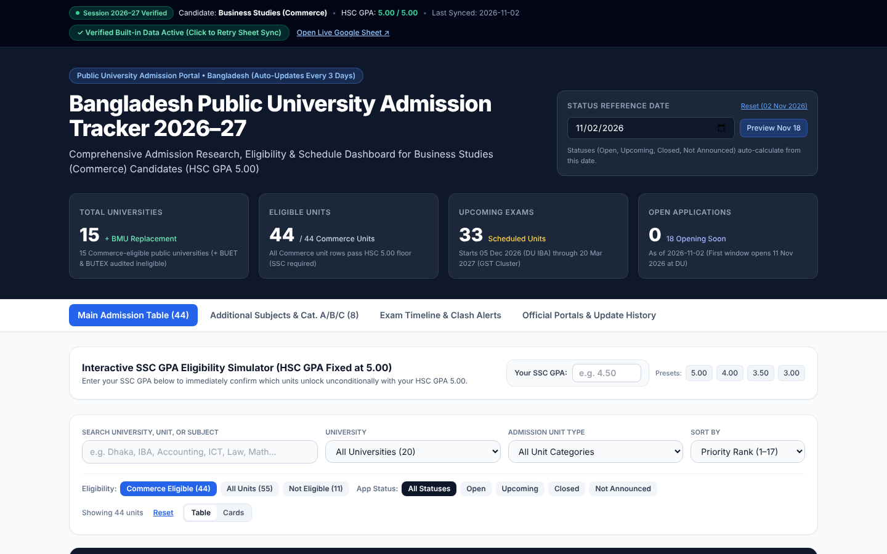
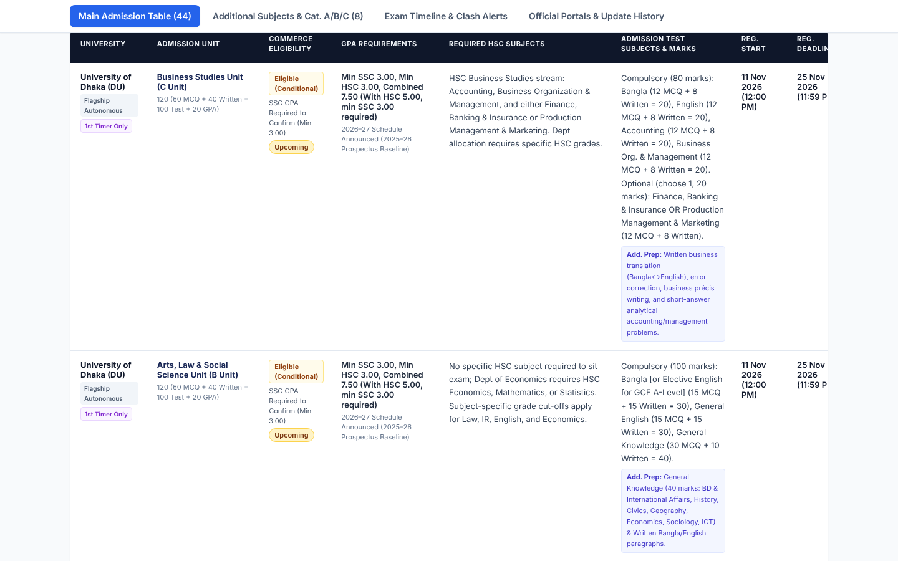
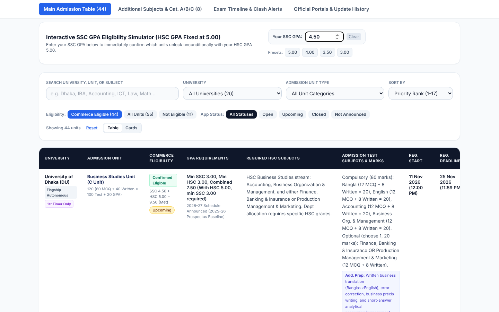
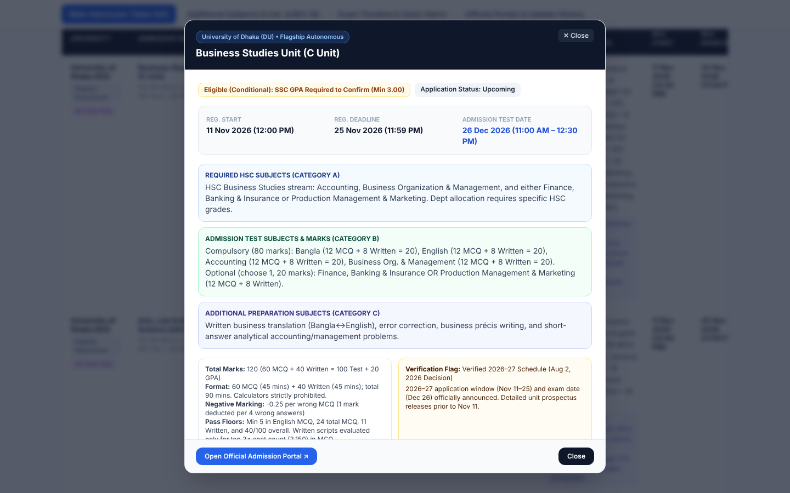
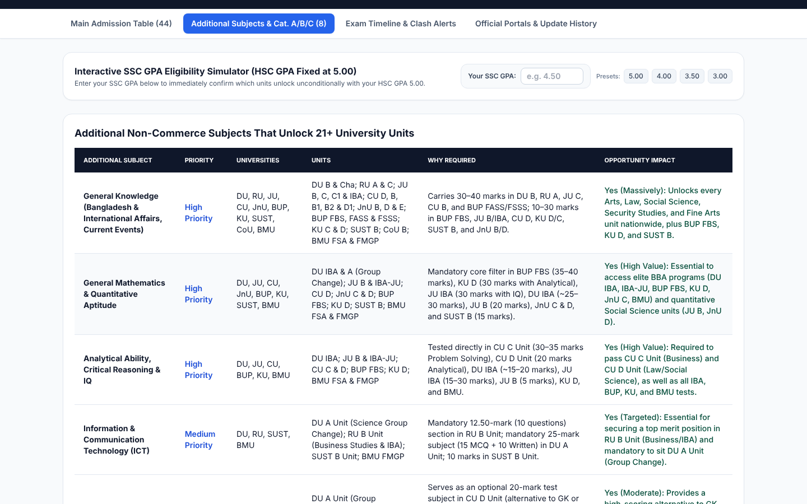
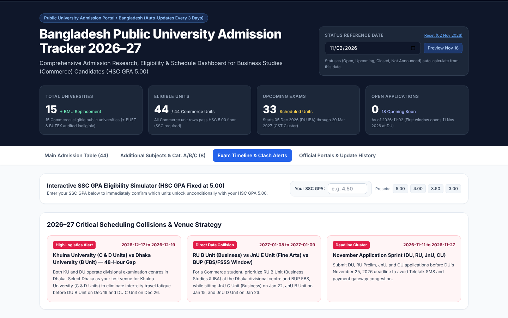
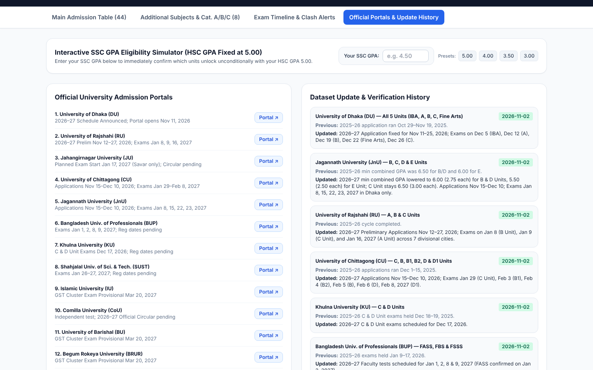
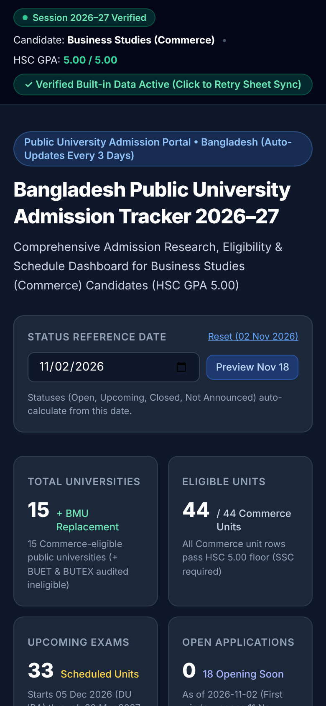

# Bangladesh Public University Admission Tracker 2026–27

A modern, responsive public university admission dashboard for **Business Studies (Commerce)** candidates holding an **HSC GPA of 5.00**. Built from the verified master research dataset in Google Docs and Google Sheets.

---

## Screenshots

| Dashboard | Admission Table |
|---|---|
|  |  |

| SSC GPA Simulator | Unit Detail |
|---|---|
|  |  |

| Additional Subjects | Timeline & Clash Alerts |
|---|---|
|  |  |

| Official Portals | Mobile |
|---|---|
|  |  |

---

## 1. Key Features

- **Single Source of Truth Dataset (`src/data/admissionsData.json`)**: Preserves all 43 unit records across 15 Commerce-eligible public universities (DU, RU, JU, CU, JnU, BUP, KU, SUST, IU, CoU, BU, BRUR, JKKNIU, JUST, and BMU as the specialized public university replacement) plus audited ineligible Science/Engineering benchmarks (BUET, BUTEX, and Science-only units).
- **Automatic Date-Based Status Engine**: Dynamically computes `Open`, `Upcoming`, `Closed`, and `Not Announced` statuses from the actual registration start/deadline dates and current reference date. Unannounced dates remain strictly blank.
- **Interactive SSC GPA Eligibility Simulator**: Because the candidate's HSC GPA is `5.00` and SSC GPA is unstated in the baseline profile, entering any SSC GPA (`1.00–5.00`) immediately recalculates which units transition from `Eligible (Conditional — SSC GPA Required)` to `Confirmed Eligible` or `Below SSC GPA Floor`.
- **Multi-Dimensional Search, Filter & Sort**:
  - Search by university name, admission unit, or exam subject (`Accounting`, `ICT`, `Analytical`, `Law`, `Math`).
  - Filter by University, Unit Category, Eligibility Status (`Commerce Eligible`, `All Units`, `Not Eligible`), and Application Status (`Open`, `Upcoming`, `Closed`, `Not Announced`).
  - Sort by Priority Rank, Admission Test Date, Registration Deadline, or Minimum Combined GPA.
- **Unit Detail Drawer/Modal**: Shows full Category A (HSC prerequisites), Category B (compulsory/optional test subjects & marks distribution), Category C (additional non-Commerce subjects), negative marking, pass floors, exam centres, verification flags, and clickable official portals.
- **Additional Subject Matrix & Schedule Clash Detector**: Dedicated views for the 8 high-leverage non-Commerce subjects and December 2026 – March 2027 date collision alerts.

---

## 2. Project Structure

```text
bd-admission-tracker/
├── dist/                                   # Pre-built production bundle (ready for instant Netlify Drop!)
│   ├── index.html                          # Complete compiled production app
│   ├── _redirects                          # Netlify SPA routing rule
│   └── data/admissionsData.json            # Externalized JSON dataset
├── public/
│   ├── _redirects
│   └── data/admissionsData.json
├── src/
│   ├── data/admissionsData.json            # Canonical structured admission dataset
│   ├── utils/admissionUtils.js             # Date status, SSC GPA calculator, filtering & sorting logic
│   ├── components/
│   │   ├── SummaryCards.jsx
│   │   ├── AdmissionTable.jsx
│   │   └── UnitDetailModal.jsx
│   ├── App.jsx
│   ├── main.jsx
│   └── index.css
├── scripts/
│   ├── update-dataset.mjs                  # Weekly dataset diff & merge CLI script
│   └── check-official-updates.mjs          # Optional weekly official circular checker
├── .github/workflows/
│   └── weekly-admission-check.yml          # Optional weekly GitHub Actions automation
├── netlify.toml                            # Netlify build & redirect configuration
├── package.json
├── vite.config.js
└── tailwind.config.js
```

---

## 3. Local Development & Production Build

### Prerequisites
- Node.js `v18+` or `v20+` and `npm`

### Commands
```bash
# 1. Install dependencies
npm install

# 2. Start local development server (http://localhost:5173)
npm run dev

# 3. Create production build in dist/
npm run build

# 4. Preview production build locally
npm run preview
```

---

## 4. Publishing to a Public Netlify URL

> **Note:** This repository is prepared for immediate Netlify deployment. It is not yet deployed to a live URL until you perform either Method A or Method B below.

### Method A: Instant Drag-and-Drop via Netlify Drop (Zero Terminal Setup)
Because this package includes a pre-built `dist/` directory:
1. Unzip `bd_admission_tracker_netlify.zip`.
2. Go to **[https://app.netlify.com/drop](https://app.netlify.com/drop)**.
3. Drag and drop the **`dist`** folder directly into your browser window.
4. Your site will be live at a public `https://<your-site-name>.netlify.app` URL in ~15 seconds.

### Method B: Connect to GitHub for Continuous Deployment (Recommended for Weekly Updates)
1. Create a new GitHub repository and push this project folder:
   ```bash
   git init
   git add .
   git commit -m "Initial commit: Bangladesh Public University Admission Tracker 2026-27"
   git branch -M main
   git remote add origin https://github.com/<your-username>/<your-repo>.git
   git push -u origin main
   ```
2. Log in to **[Netlify](https://app.netlify.com/)** and click **"Add new site" → "Import an existing project" → "GitHub"**.
3. Select your repository. Netlify automatically detects `netlify.toml`:
   - **Build command:** `npm run build`
   - **Publish directory:** `dist`
4. Click **Deploy site**.

### Updating Data Without Rebuilding Manually
- When connected via GitHub + Netlify, you can edit `src/data/admissionsData.json` (and `public/data/admissionsData.json`) directly in the GitHub web editor and commit. Netlify will automatically publish the updated dataset in ~25 seconds without you needing to run any local build commands.
- You can also use the **in-app "Weekly Data Update / Diff" modal** to update unit dates, preview changes immediately, and click **"Download JSON"** to export your updated `admissionsData.json`.

---

## 5. Weekly Data Update Workflow (`npm run update-data`)

Whenever a university publishes a new circular or exam date:
1. **Via AI Agent**: Provide your updated Google Doc, Sheet, CSV, or JSON to your AI agent and say **"Update Admission Tracker"**. The agent will diff the new information against `src/data/admissionsData.json`, preserve unchanged fields, flag any unverified changes, and regenerate the package.
2. **Via CLI Script**:
   ```bash
   npm run update-data -- ./path/to/updated-units.json
   ```
   The script compares each unit record, updates modified fields, logs a timestamped entry in `updateHistory`, and writes the updated JSON to `src/data/admissionsData.json` and `public/data/admissionsData.json`.

---

## 6. Optional Weekly Automation (`.github/workflows/weekly-admission-check.yml`)

An optional GitHub Actions workflow is included at `.github/workflows/weekly-admission-check.yml`.
- **How It Works**: When pushed to a GitHub repository with GitHub Actions enabled, it runs `node scripts/check-official-updates.mjs` every Sunday at 6:00 AM BST (00:00 UTC) or on manual trigger (`workflow_dispatch`).
- **Safety Guardrails**: It checks official university portals (`admission.eis.du.ac.bd`, `admission.ru.ac.bd`, `ju-admission.org`, `admission.cu.ac.bd`, `admission.jnu.ac.bd`, `admission.bup.edu.bd`, `apply.ku.ac.bd`, `admission.sust.edu.bd`, `cou.ac.bd`, `gstadmission.ac.bd`, `applyonline.bsmrmu.edu.bd`), records the `lastChecked` timestamp, and never overwrites verified dates with unverified scraped text.
